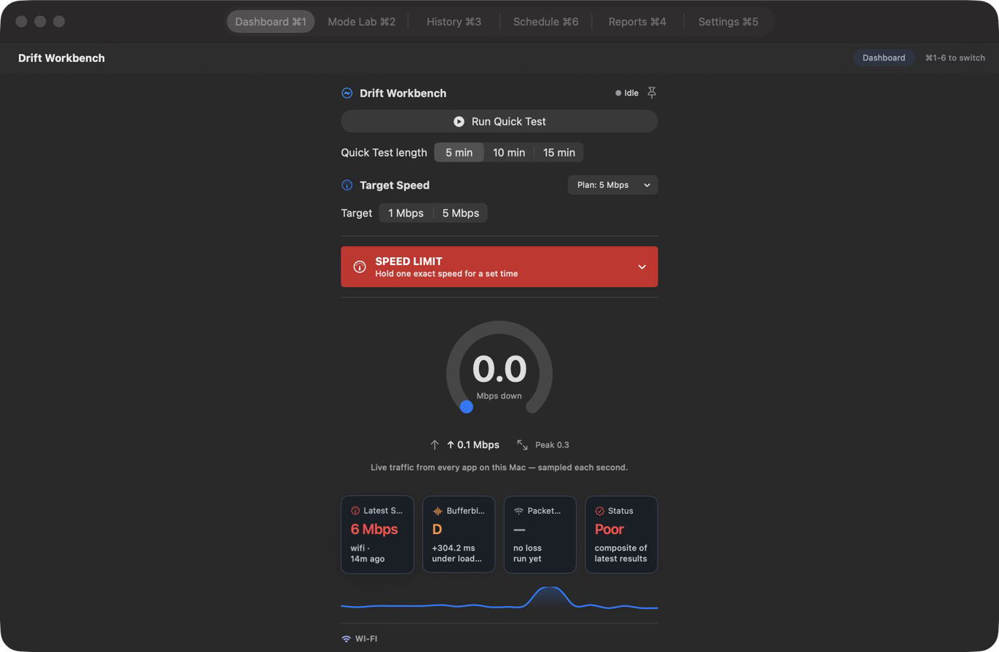
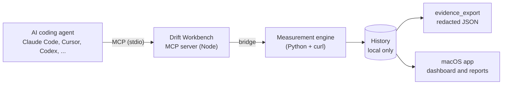

<div align="center">


# Drift Workbench

**Network diagnostics your AI coding agent can run itself.**

Local-first measurements for throughput, bufferbloat, jitter, packet loss and DNS,
exposed as MCP tools, with timestamped evidence you can hand to anyone.

[](https://www.npmjs.com/package/@drift-workbench/mcp-server)
[](LICENSE)
[](https://modelcontextprotocol.io)
[](#desktop-app)
[](#privacy-and-security)

[Quickstart](#quickstart) ·
[Tools](#tools) ·
[How it works](#how-it-works) ·
[Desktop app](#desktop-app) ·
[Privacy](#privacy-and-security) ·
[Development](#development)

<br>



<sub>The macOS app, private preview build.</sub>

</div>

<br>

## Why

An AI coding agent can read your code, run your tests and open your files. It cannot tell
whether the network is the reason a build, a download or an API call is slow, because it
has no way to measure it. Drift Workbench gives it that: a small set of measurement tools
it can call directly, answers it can reason about, and an evidence export when you need to
show someone else.

- **Measured, not guessed.** Every number comes from a probe that ran on your machine.
- **Local-first.** No accounts, no telemetry. Nothing leaves your machine unless you send it.
- **Honest limits.** It reports what the line delivered and says plainly when that falls short.

## Quickstart

Requires Node.js, Python 3 and `curl`. Nothing else to install.

```bash
npx -y @drift-workbench/mcp-server
```

Add it to your agent. For Claude Code:

```bash
claude mcp add drift-workbench -- npx -y @drift-workbench/mcp-server
```

For any other MCP client, add this to its server configuration:

```json
{
  "mcpServers": {
    "drift-workbench": {
      "command": "npx",
      "args": ["-y", "@drift-workbench/mcp-server"]
    }
  }
}
```

Then ask your agent something like *"Run a full diagnostic and tell me whether the network
or my code is the bottleneck."*

## Tools

The published package, `@drift-workbench/mcp-server@1.0.8`, ships **20 tools**.

| | Tool | What it does |
|---|---|---|
| **Measure** | `measure_speed` | Download throughput with one or more parallel streams |
| | `upload_speed` | Upload throughput in Mbps |
| | `packet_loss` | Packet loss percentage |
| | `jitter` | Variation in packet arrival time |
| | `wifi_info` | Signal strength, noise and channel from the system profiler |
| | `download_file` | Multi-stream ranged download of one HTTP resource |
| **Diagnose** | `bufferbloat` | Latency increase under load, graded A+ to F |
| | `eco_bloat` | A light bufferbloat estimate that moves about 100 KB |
| | `dns_ranking` | Public DNS resolvers ranked by median latency |
| | `full_diagnostics` | Throughput, DNS and bufferbloat in a single call |
| | `diagnostic_summary` | A short health overview |
| | `boost` | Baseline against parallel-stream throughput, with the gain |
| | `parallel_diagnostics` | Several independent tests run concurrently in one call |
| **Evidence** | `evidence_export` | A redacted, timestamped evidence bundle (JSON), with a SHA-256 per record |
| | `ai_analyze` | Analysis of measurements you already have. It never measures or changes the system |
| | `list_analyses` | The analyses `ai_analyze` can run, with their inputs |
| **Control** | `strict_limit` | A system-wide download ceiling for a set time (macOS, needs root) |
| | `policy_bound_workflow` | Fixed, envelope-checked measurement sequences |
| | `fleet_drift_workbench` | Fleet baselines and drift checks against allowlisted HTTPS peers |
| | `session_info` | Server uptime and call count |

**In the source, not yet published to npm (26 tools in total):** `path_trace`, `http_timing`,
`captive_portal_check`, `ipv6_check`, `mtu_probe` and `network_context`.

## How it works



The MCP server and the macOS app share one measurement engine, so a number your agent reads
is the same number the app shows. History is stored on your machine and every export is
redacted before it leaves the engine. The evidence bundle carries a SHA-256 per record and
contains no IPv4 or MAC addresses.

**Measured on one M2 Max Mac** (MCP server limits, not a guarantee for other hardware):

| Limit | Result |
|---|---|
| First result, p95 | 3.47 s |
| Cancellation | 0.064 s |
| Peak memory | 183 MiB |
| Idle CPU | 0.0% |

## Desktop app

A native macOS app (macOS 13 or later, Apple Silicon and Intel) built on the same engine:
quick tests, a held target rate, history, scheduled runs, anomaly detection, and
timestamped evidence reports.

- **Founding License: $29, one payment.** A 14-day trial runs first, bound to your machine,
  with no account. [Get it on Gumroad](https://mubasharali03.gumroad.com/l/yzkuez).
- **The MCP server is free and stays free.**
- **Status: private preview.** Public launch is paused. The app is not yet notarized, so
  macOS asks you to confirm the first open.

## Honest limits

- Drift Workbench cannot exceed your ISP cap. No software can. It reports what your line
  delivered and says so when that falls short of the plan.
- Parallel-stream gains appear only when the pipe is contended. On an idle line the
  single-stream baseline already equals the plan.
- Router-side QoS limits override everything here.
- Zero-throughput windows on shared Wi-Fi are real. They are reported as dropouts, not
  smoothed into a flattering percentage.
- Windows support is limited. The probe parsers are validated against real Windows 11
  captures; the full Windows test suite has not been run yet.

## Privacy and security

- **Local-first data.** Run history lives in `~/Library/Application Support/NetMaxDesktop/`
  with `0600` permissions.
- **No listeners by default.** The CLI and desktop app open no network ports. The optional
  MCP HTTP transport (`--http`) binds to `127.0.0.1:8808`; a non-loopback bind requires a
  bearer token.
- **Privileged actions are bounded.** `strict_limit` needs root, checks ownership before
  elevating, tracks its state atomically and removes its rules when it finishes.
- **Remote AI is off by default.** It can be enabled only in the desktop app (Settings,
  Remote AI Privacy). When enabled it sends allowlisted aggregate metrics only, never raw
  history, prompts, SSIDs, hostnames or addresses. See
  [`docs/privacy`](docs/privacy) and [`docs/THREAT-MODEL.md`](docs/THREAT-MODEL.md).
- **Retention you control.** Archive by age, undo a clear within 30 seconds, or erase
  permanently.

## Repository layout

| Path | Contents |
|---|---|
| [`desktop/`](desktop) | MCP server (`netmax-mcp-server.mjs`), the shared engine, the engine bridge and the native macOS app (`SwiftNetMax`) |
| [`netmax.py`](netmax.py) and `netmax_*.py` | The measurement engine and its CLI modules |
| [`trial-server-worker/`](trial-server-worker) | Cloudflare Worker for the trial and license registry |
| [`website-v3/`](website-v3) | The marketing site (static Next.js export) |
| [`landing/`](landing) | Static landing page |
| [`docs/`](docs) | Specs, threat model, privacy contracts and test plans |
| [`tests/`](tests) | Offline test suites, network fully mocked |

> Some file names, environment variables (`NETMAX_*`) and the app's data folder keep the
> earlier **NetMax** name so existing installs and configurations keep working.

## Development

Run the engine directly, with no package install:

```bash
python3 netmax.py full --seconds 10      # everything plus a verdict
python3 netmax.py bloat --seconds 12     # bufferbloat grade
python3 netmax.py dns                    # rank resolvers by latency
python3 netmax.py limit --mbps 2 --seconds 1800   # hold a fixed rate
```

Run the tests:

```bash
python3 -m pytest                          # engine, GUI, modules, bridge and store
python3 -m ruff check .                    # lint
bash desktop/scripts/run_swift_selftests.sh   # native app self-checks
```

Build the macOS app:

```bash
bash desktop/scripts/build_app.sh          # produces desktop/build/Drift Workbench.app
```

Release history is in [`RELEASE-NOTES.md`](RELEASE-NOTES.md).

## License

[MIT](LICENSE). Built by Mubashar Ali. Questions: mubashar@mubasharbuilds.com.
